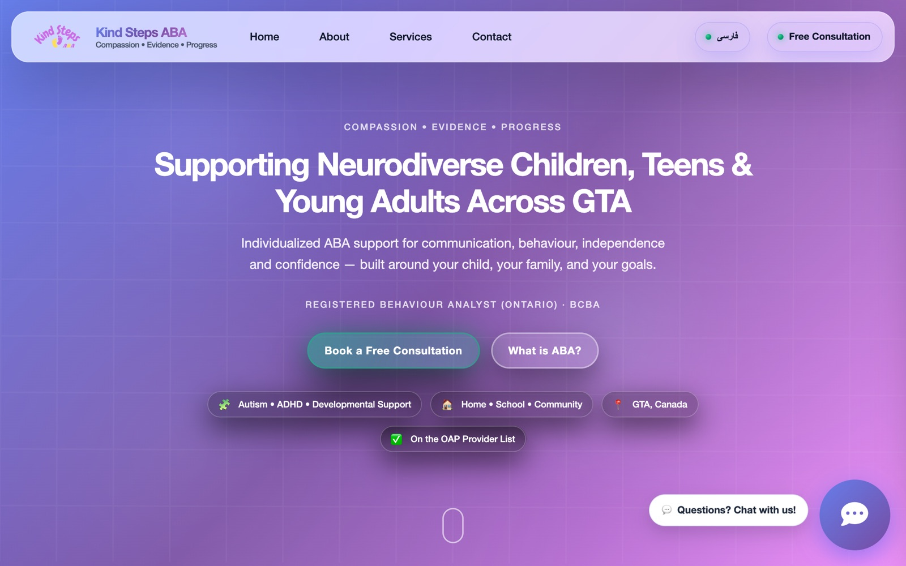

<div align="center">

# 🧩 Kind Steps ABA

The website for Kind Steps, an ABA therapy provider supporting neurodiverse children, teens and young adults across the GTA, in English and Persian.

<a href="https://kindsteps.ca/"></a>
<a href="https://github.com/miladmo68/Kind-Steps-"></a>
<a href="https://miladweb.com"></a>

**🔗 Live:** [kindsteps.ca](https://kindsteps.ca/)

</div>

<p align="center">
  
</p>

## ✨ Features

- Bilingual site (English and Persian)
- Services, about and free-consultation sections
- Contact form handled by a serverless email function
- Accessible, calm visual design

## 🛠️ Tech Stack

    

## 🚀 Getting Started

**Prerequisites:** [Node.js](https://nodejs.org/) 18 or newer

**Install and run**

```bash
git clone https://github.com/miladmo68/Kind-Steps-.git
cd Kind-Steps-
npm install
npm start
```

## 📁 Project Structure

```
Kind-Steps-/
├── api/
├── images/
├── index-fa.html
├── index.html
├── package.json
├── templatemo-personal-javascripts.js
└── templatemo-personal-style.css
```

## 👤 Author

**Milad Mohammadi** — Frontend-Focused Full-Stack Developer, Toronto 🇨🇦

[](https://miladweb.com)
[](https://www.linkedin.com/in/miladmo68/)
[](https://github.com/miladmo68)

<p align="center"><sub>If you like this project, consider giving it a ⭐</sub></p>
